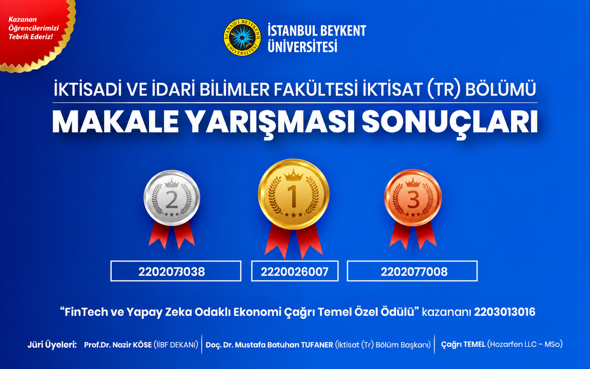
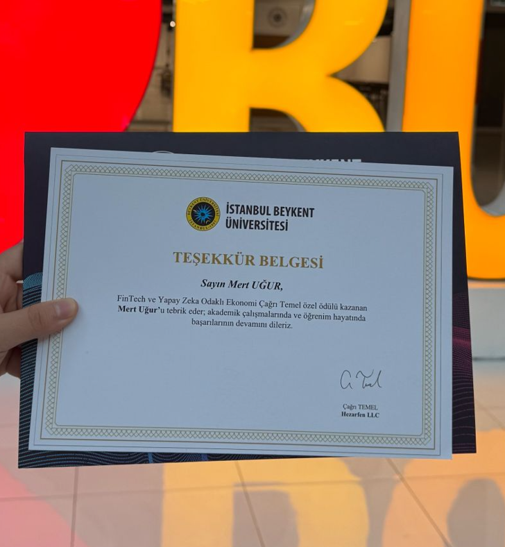

# FinTech Devriminde Karar Kimde: İnsan mı Yapay Zeka mı?

Finans ve teknolojiye olan ilgimi bir araya getirdiğim bu çalışmada, FinTech ekosisteminde finansal kararların insan uzmanlığı mı yoksa yapay zekâ mı tarafından daha etkili şekilde verilebileceğini araştırdım.

Güncel akademik çalışmalar ve sektör raporları üzerinden insan ve yapay zekâyı; veri işleme kapasitesi, hız, belirsizlik altında karar verme, bağlamsal yorumlama, etik sorumluluk ve güvenilirlik gibi başlıklarda karşılaştırdım.

## Öne Çıkan Bulgular

- Yapay zekâ, yüksek hacimli verilerin hızlı ve tutarlı şekilde işlenmesinde öne çıkıyor.
- İnsan uzmanlığı, belirsizlik, bağlamsal yorumlama ve etik sorumluluk gerektiren kararlarda daha güçlü kalıyor.
- Çalışmanın temel sonucu, en dengeli yaklaşımın insan uzmanlığı ile yapay zekânın birlikte kullanıldığı **hibrit karar modelleri** olduğu yönünde.

## Ödül ve Yarışma

Bu çalışma, İstanbul Beykent Üniversitesi İktisat Bölümü tarafından düzenlenen **İktisat Makale Yarışması** kapsamında hazırlandı.

Yarışma kuralları gereği çalışmalar **1.500–3.000 kelime aralığında** hazırlanıyor ve özgünlük, analiz, değerlendirme ve sonuç yapısı üzerinden değerlendiriliyordu.

Çalışmam, **“FinTech ve Yapay Zeka Odaklı Ekonomi Çağrı Temel Özel Ödülü”**ne layık görüldü.

### Yarışma Sonucu

### Ödül Belgesi

## Makalenin Tamamı

📄 [Makalenin PDF dosyasını görüntüle](./FinTech_Devriminde_Karar_Kimde.pdf)

## Konular

`FinTech` `Yapay Zeka` `Finansal Karar Verme` `İnsan-Yapay Zeka İş Birliği` `Karar Destek Sistemleri` `AI Ethics`
